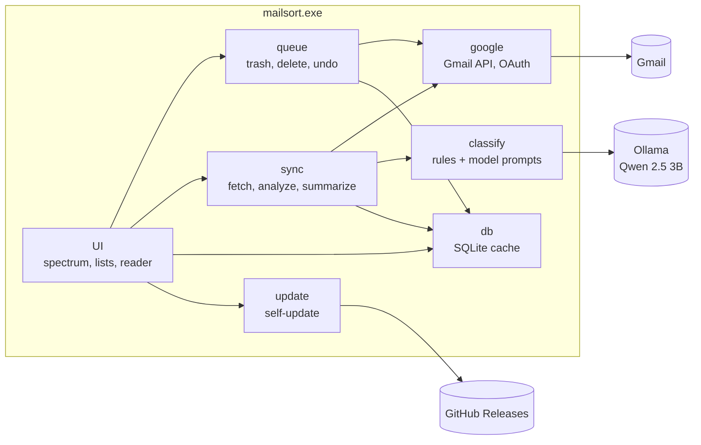

<div align="center">

<picture>
  <source media="(prefers-color-scheme: dark)" srcset="assets/logo-dark.svg">
  
</picture>

# mailsort

My Gmail inbox, sorted by a model running on my own machine: emails grouped by who sent them and what about, each group with a summary and a verdict, and cleaned up in a few clicks.


**[Try the demo](https://nikbogman.github.io/mailsort/)**: the real UI in the browser, with made-up mail.

</div>

## Why I built it

I get **a lot of email and never sorted any of it**, so years of it piled up. I wanted something to **go through it for me**: tell the bank from the newsletters, and tell me what can go.

It uses a **local model, Qwen 2.5 3B through Ollama**, because I don't want a cloud model reading my inbox. Not because any single email is a big secret, but because **an inbox is the master key to everything else**: every password reset, sign-in code and bank notice lands there. Whoever can read it can get into the rest, so it stays on my machine.

## What it does

- **Sorts.** Each email gets a category (Personal, Work, Admin, Security, Receipts, Dev Tools, Newsletters, Promotions and more) and an organization and topic. Known senders are matched by rules before the model sees them.
- **Groups.** Emails from the same organization about the same thing become one card, so 200 LinkedIn mails are one decision, not 200.
- **Judges.** Each group gets a summary and a verdict: **Keep**, **Review** or **Can go**. Mail written by a person is never marked Can go.
- **Cleans up.** Trash a group or a selection, delete forever, undo, and browse Gmail's Trash.

## How it fits together



- **Sync** pulls new inbox headers, has the model give each email a category, organization and topic, then summarizes each changed group with a verdict.
- **Queue** removes emails from the screen at once and runs the Gmail calls in the background, so Undo and Stop work.
- **The demo** is the same UI compiled to WebAssembly, with `db`, `google` and `sync` swapped for in-memory fakes ([src/demo/](src/demo/)).

## Why a desktop app, in Rust

It runs **next to Ollama**, on the same machine, so a desktop app was the natural fit. **Rust with Dioxus** makes it **fast and all in one**: one binary for the UI, the Gmail sync and the SQLite cache, with no React, no bundler and no separate frontend to look after. I considered **Tauri**, but dropped it for convenience: Dioxus keeps everything in one language and one project.

## Run it

It needs [Rust](https://rustup.rs), [Ollama](https://ollama.com) and a Google Cloud project.

1. Google Cloud: enable the **Gmail API**, set up the consent screen (External, me as a test user), create a **Desktop app** OAuth client and download its JSON.
2. Pull the model:

   ```sh
   ollama pull qwen2.5:3b   # or another model, set with MAILSORT_MODEL
   ```

3. Build and start:

   ```sh
   cargo build --release
   target\release\mailsort.exe
   ```

4. Click **Open folder**, save the JSON there as `credentials.json`, click **Continue** and sign in to Google in the browser.

On launch it starts Ollama if needed and syncs new inbox mail; the **Sync** button in the top bar runs it again. Data lives in `%APPDATA%\mailsort\data` (`credentials.json`, `token.json`, `mail.db`).

Checks:

```sh
cargo test
```

## Updates

The app checks GitHub Releases on start and shows **Update to vX.Y.Z** in the top bar when a newer one exists; one click downloads it, replaces the exe and restarts. To publish one: bump `version` in `Cargo.toml`, commit, then

```sh
git tag v0.2.0 && git push --tags
```

and the release workflow builds `mailsort.exe` and attaches it to the release.

## Web demo

```sh
rustup target add wasm32-unknown-unknown
cargo install wasm-bindgen-cli --version <version of wasm-bindgen in Cargo.lock>
sh web/build.sh   # writes dist/, serve it with any static server
```

Every push to `main` publishes it to GitHub Pages.

## Scope and privacy

- **Personal tool.** Built for my own inbox on Windows. The desktop app isn't packaged or tested for other platforms.
- **Local by design.** Mail only travels between this machine and Gmail. The model, its prompts and the SQLite cache never leave the machine, and there's no telemetry.
- **Google sign-in.** It uses your own Google Cloud OAuth client in testing mode, so only accounts you add as test users can sign in.

## Built with AI

All code written by Claude (Claude Code).
